<div align="center">

# Лабораторная работа №1: Настройка среды разработки и первый HTTP-сервер

**Студент:** Ануфриев Владислав Денисович  
**Группа:** ПИЖ-б-о-25-2  
**Вариант:** 2  
**Технология:** Node.js + Express  
</div>

---

## Содержание

- [Цель работы](#цель-работы)
- [Теоретическое обоснование](#теоретическое-обоснование)
- [Выполнение практического примера](#выполнение-практического-примера)
- [Выполнение индивидуального задания](#выполнение-индивидуального-задания)
- [Контрольные вопросы](#контрольные-вопросы)
- [Вывод](#вывод)
- [Список использованных источников](#список-использованных-источников)

---

## Цель работы
Освоить установку инструментов для бэкенд-разработки, создать и запустить минимальный веб-сервер, обрабатывающий GET-запросы, понять концепцию эндпоинтов, научиться настраивать автоматический перезапуск сервера.

---

## Теоретическое обоснование

Бэкенд — это серверная часть веб-приложения, которая обрабатывает запросы клиентов, выполняет бизнес-логику и возвращает ответы. Взаимодействие строится по модели «клиент-сервер», где клиент отправляет HTTP-запрос, а сервер возвращает HTTP-ответ.

Эндпоинт — это конкретный URL и метод HTTP, по которому клиент обращается к серверу. В данной работе используются GET-запросы для получения данных. Ответы могут быть в формате текста или JSON (JavaScript Object Notation) — стандарта обмена данными в REST API.

Для разработки выбран стек Node.js + Express. Node.js позволяет запускать JavaScript на сервере, а Express — минималистичный фреймворк, упрощающий обработку запросов, маршрутизацию и формирование ответов. Для автоматического перезапуска сервера используется пакет nodemon.

---

## Выполнение практического примера

### Код сервера (app.js)

```javascript
const express = require('express');
const app = express();
const port = 3000;

// Консольное логирование каждого запроса
app.use((req, res, next) => {
    console.log(`[${new Date().toISOString()}] ${req.method} ${req.url}`);
    next();
});

// 1. Текстовый эндпоинт
app.get('/', (req, res) => {
    res.send('Добро пожаловать на базовый сервер!');
});

// 2. JSON эндпоинт 1
app.get('/api/status', (req, res) => {
    res.json({ status: 'ok', uptime: process.uptime() });
});

// 3. JSON эндпоинт 2
app.get('/api/info', (req, res) => {
    res.json({ author: 'Student', version: '1.0.0' });
});

// 4. JSON эндпоинт с параметром
app.get('/api/users/:id', (req, res) => {
    res.json({
        message: 'Информация о пользователе',
        userId: req.params.id
    });
});

// Обработка 404
app.use((req, res) => {
    res.status(404).json({ error: 'Маршрут не найден' });
});

app.listen(port, () => {
    console.log(`Сервер запущен на http://localhost:${port}`);
});
```

## Результаты работы

Ниже представлены скриншоты, демонстрирующие работу всех эндпоинтов сервера.

### 1. Главная страница (текстовый ответ)
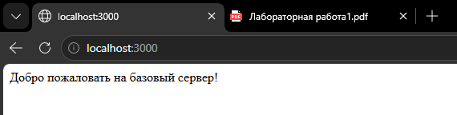

### 2. Статус сервера (/api/status)
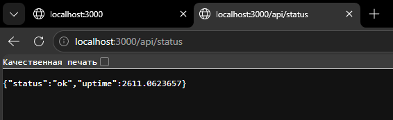

### 3. Информация о сервере (/api/info)
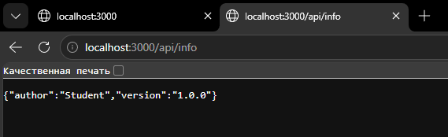

### 4. Пользователь с ID = 5 (/api/users/5)
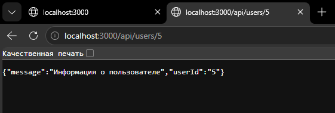

### 5. Пользователь с ID = 123 (/api/users/123)
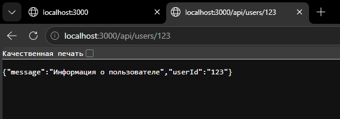

### 6. Информация о пользователе
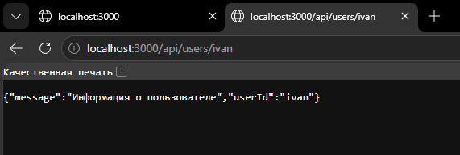

### 7. Обработка 404 ошибки (несуществующий маршрут)
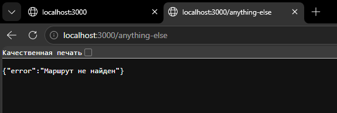

### 8. Логирование запросов в консоли
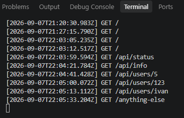

## Задание 1. Базовый уровень

**Требования:** 2 эндпоинта (1 текстовый на корневом маршруте `/` и 1 JSON). Настроить автоматический перезапуск.

**Вариант 2:**
- Корневой маршрут `/` → `"Hello, World!"`
- JSON-эндпоинт `/api/date` → `{"date": "2024-01-01", "day": "Monday"

---

### Код сервера

```javascript
const express = require('express');
const app = express();
const port = 3000;

app.use((req, res, next) => {
    console.log(`[${new Date().toISOString()}] ${req.method} ${req.url}`);
    next();
});

app.get('/', (req, res) => {
    res.send('Hello, World!');
});

app.get('/api/date', (req, res) => {
    res.json({
        date: "2024-01-01",
        day: "Monday"
    });
});

app.use((req, res) => {
    res.status(404).json({ error: 'Маршрут не найден' });
});

app.listen(port, () => {
    console.log(`Сервер запущен на http://localhost:${port}`);
});
```

### Результаты работы

**1. Корневой маршрут `/`**

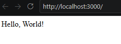

**2. JSON-эндпоинт `/api/date`**

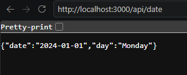

## Задание 2. Средний уровень

**Требования:** 3 эндпоинта (1 текстовый на `/` и 2 различных JSON-эндпоинта). Настроить автоматический перезапуск. Добавить кастомичную обработку ошибки 404 (Not Found) с возвратом JSON формата `{"error": "Not Found"}`.

**Вариант 2:**
- JSON-эндпоинт 1: `/api/posts` — статический список постов
- JSON-эндпоинт 2: `/api/tags` — список тегов

---

### Код сервера (задание 2)

```javascript
const express = require('express');
const app = express();
const port = 3000;

app.use((req, res, next) => {
    console.log(`[${new Date().toISOString()}] ${req.method} ${req.url}`);
    next();
});

app.get('/', (req, res) => {
    res.send('Hello, World!');
});

app.get('/api/posts', (req, res) => {
    const posts = [
        { id: 1, title: 'Первый пост', content: 'Содержание первого поста' },
        { id: 2, title: 'Второй пост', content: 'Содержание второго поста' },
        { id: 3, title: 'Третий пост', content: 'Содержание третьего поста' }
    ];
    res.json(posts);
});

app.get('/api/tags', (req, res) => {
    const tags = [
        { id: 1, name: 'JavaScript' },
        { id: 2, name: 'Node.js' },
        { id: 3, name: 'Express' },
        { id: 4, name: 'Backend' }
    ];
    res.json(tags);
});

app.use((req, res) => {
    res.status(404).json({ error: 'Not Found' });
});

app.listen(port, () => {
    console.log(`Сервер запущен на http://localhost:${port}`);
});
```

---

### Результаты работы

**1. Корневой маршрут `/`**

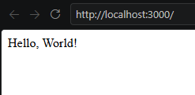

**2. JSON-эндпоинт `/api/posts`**

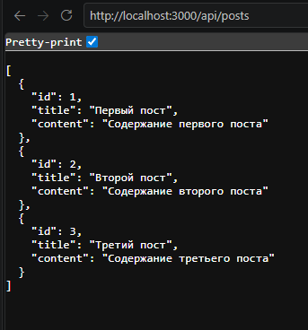

**3. JSON-эндпоинт `/api/tags`**

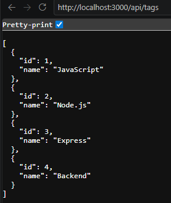

**4. Обработка 404 ошибки**

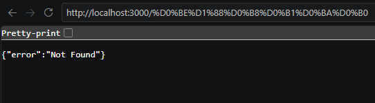


## Задание 3. Высокий уровень

**Требования:**
- 5 эндпоинтов (1 текстовый, 2 простых JSON-эндпоинта, 1 JSON-эндпоинт с параметром в пути, 1 обработчик 404)
- Автоматический перезапуск
- Реализация простого консольного логирования всех входящих запросов (метод + URL + время)

**Вариант 2:**
- Сущность 1 (коллекция): `/api/users` — список пользователей
- Сущность 2 (коллекция): `/api/companies` — список компаний
- Эндпоинт с параметром: `/api/users/:id` — пользователь по ID

---

### Код сервера (задание 3)

```javascript
const express = require('express');
const app = express();
const port = 3000;

app.use((req, res, next) => {
    console.log(`[${new Date().toISOString()}] ${req.method} ${req.url}`);
    next();
});

app.get('/', (req, res) => {
    res.send('Hello, World!');
});

app.get('/api/users', (req, res) => {
    const users = [
        { id: 1, name: 'Алексей Иванов', email: 'alex@mail.ru' },
        { id: 2, name: 'Мария Петрова', email: 'maria@mail.ru' },
        { id: 3, name: 'Дмитрий Сидоров', email: 'dmitry@mail.ru' }
    ];
    res.json(users);
});

app.get('/api/companies', (req, res) => {
    const companies = [
        { id: 1, name: 'ООО "ТехноПром"', city: 'Москва' },
        { id: 2, name: 'ЗАО "ИнноСофт"', city: 'Санкт-Петербург' },
        { id: 3, name: 'ООО "ДиджиталСервис"', city: 'Казань' }
    ];
    res.json(companies);
});

app.get('/api/users/:id', (req, res) => {
    const userId = req.params.id;
    res.json({
        message: 'Информация о пользователе',
        userId: userId
    });
});

app.use((req, res) => {
    res.status(404).json({ error: 'Not Found' });
});

app.listen(port, () => {
    console.log(`Сервер запущен на http://localhost:${port}`);
});
```

### Результаты работы

**1. JSON-эндпоинт `/api/users`**

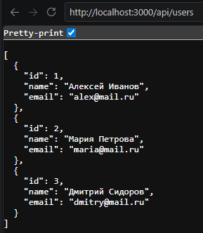

**2. JSON-эндпоинт `/api/companies`**

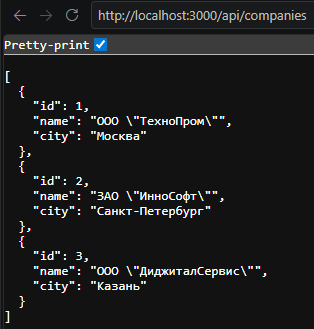

**3. JSON-эндпоинт с параметром `/api/users/20`**

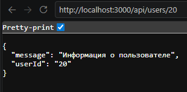

**4. Обработка 404 ошибки**

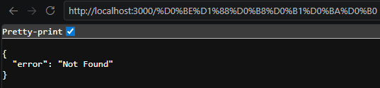

## 6. Ответы на контрольные вопросы

**1. Что такое бэкенд и чем он отличается от фронтенда?**

**Ответ:** Бэкенд — это серверная часть веб-приложения, которая отвечает за обработку запросов, бизнес-логику, взаимодействие с базой данных и генерацию ответов. Фронтенд — это клиентская часть, которая отвечает за отображение данных пользователю и взаимодействие с интерфейсом.

---

**2. Что такое эндпоинт?**

**Ответ:** Эндпоинт — это конкретный URL и метод HTTP, по которому клиент обращается к серверу. Например, `GET /api/users` — это эндпоинт для получения списка пользователей.

---

**3. Для чего используется формат JSON?**

**Ответ:** JSON (JavaScript Object Notation) — это текстовый формат обмена данными, основанный на синтаксисе JavaScript. Он используется для передачи данных между клиентом и сервером в REST API благодаря своей легкости, читаемости и поддержке всеми современными языками программирования.

---

**4. Какая функция Express отвечает за обработку GET-запросов?**

**Ответ:** Метод `app.get()` используется для обработки GET-запросов. Он принимает два аргумента: путь (URL) и функцию-обработчик, которая выполняется при обращении к этому пути.

---

**5. Для чего используется пакет nodemon?**

**Ответ:** Nodemon — это инструмент, который автоматически отслеживает изменения в файлах проекта и перезапускает сервер при их обнаружении. Это значительно ускоряет процесс разработки, избавляя от необходимости вручную перезапускать сервер после каждого изменения кода.

---

**6. Как в Express получить параметры из URL (например, `/api/users/:id`)?**

**Ответ:** Параметры из URL получаются через объект `req.params`. Например, для эндпоинта `/api/users/:id` значение `id` доступно как `req.params.id`.

---

## 7. Вывод

В ходе выполнения лабораторной работы №1 были освоены базовые навыки настройки среды разработки для бэкенд-проектов на Node.js и Express.

Были созданы и запущены HTTP-серверы, обрабатывающие GET-запросы по различным эндпоинтам:

- **Задание 1 (Базовый уровень):** реализованы 2 эндпоинта — текстовый на корневом маршруте и JSON-эндпоинт с датой.
- **Задание 2 (Средний уровень):** реализованы 3 эндпоинта — текстовый, список постов и список тегов, добавлена кастомичная обработка 404 ошибки.
- **Задание 3 (Высокий уровень):** реализованы 5 эндпоинтов — текстовый, список пользователей, список компаний, эндпоинт с параметром и обработчик 404.

В ходе работы были изучены:

- Установка и настройка Node.js и Express
- Создание обработчиков GET-запросов
- Работа с маршрутами и параметрами URL
- Формирование JSON-ответов
- Настройка автоматического перезапуска сервера с помощью nodemon
- Логирование запросов в консоль
- Обработка ошибок 404
---

## 8. Список использованных источников

1. **Официальная документация Node.js** — [https://nodejs.org/](https://nodejs.org/)

2. **Официальная документация Express** — [https://expressjs.com/](https://expressjs.com/)

3. **Документация Nodemon** — [https://nodemon.io/](https://nodemon.io/)

4. **Документация JSON** — [https://www.json.org/](https://www.json.org/)

5. **REST API Tutorial** — [https://restfulapi.net/](https://restfulapi.net/)

6. **MDN Web Docs - HTTP** — [https://developer.mozilla.org/ru/docs/Web/HTTP](https://developer.mozilla.org/ru/docs/Web/HTTP)

7. **Express.js - Обработка ошибок** — [https://expressjs.com/ru/guide/error-handling.html](https://expressjs.com/ru/guide/error-handling.html)