# Лабораторная работа №2: HTTP-методы и CRUD-операции

**Студент:** Ануфриев Владислав Денисович  
**Группа:** ПИЖ-б-о-25-2  
**Вариант:** 2 (Пользователи / users)  
**Уровень:** Продвинутый  
**Технология:** Node.js + Express

---

## Цель работы

Освоить обработку различных HTTP-методов (GET, POST, PUT, PATCH, DELETE) в Express. Научиться реализовывать CRUD-операции над коллекцией объектов, хранящейся в памяти сервера, а также возвращать корректные HTTP-коды ответов (200, 201, 204, 400, 404, 500). Дополнительно: реализовать поиск, сортировку, пагинацию, массовые операции, статистику, логирование в файл и глобальный обработчик ошибок.

---

## Теоретическое обоснование

### Что такое CRUD

**CRUD** — это акроним, обозначающий четыре базовые операции над данными:

| Операция | Расшифровка | HTTP-метод | SQL-аналог |
|----------|-------------|------------|------------|
| Create   | Создание    | POST       | INSERT     |
| Read     | Чтение      | GET        | SELECT     |
| Update   | Обновление  | PUT / PATCH| UPDATE     |
| Delete   | Удаление    | DELETE     | DELETE     |

**Аналогия:** Представьте библиотеку. CRUD — это:
- **Create** — принести новую книгу и поставить на полку.
- **Read** — найти и прочитать книгу.
- **Update** — заменить старую книгу на новое издание.
- **Delete** — выбросить книгу.

---

### HTTP-методы подробнее

#### GET — получение данных

- **Назначение:** запросить данные с сервера.
- **Тело запроса:** отсутствует.
- **Идемпотентность:** да (повторный запрос не меняет состояние).
- **Безопасность:** да (не изменяет данные).
- **Коды ответов:** 200 OK, 404 Not Found.

```
GET /users      → получить всех пользователей
GET /users/5    → получить пользователя с ID=5
```

#### POST — создание данных

- **Назначение:** создать новый ресурс.
- **Тело запроса:** содержит данные нового ресурса.
- **Идемпотентность:** нет (два одинаковых запроса создадут два ресурса).
- **Безопасность:** нет (изменяет данные).
- **Коды ответов:** 201 Created, 400 Bad Request.

```
POST /users     → создать нового пользователя
```

#### PUT — полное обновление

- **Назначение:** полностью заменить существующий ресурс.
- **Тело запроса:** содержит новые данные ресурса.
- **Идемпотентность:** да (повторный запрос даёт тот же результат).
- **Безопасность:** нет (изменяет данные).
- **Коды ответов:** 200 OK, 404 Not Found.

```
PUT /users/5    → заменить пользователя с ID=5
```

#### PATCH — частичное обновление

- **Назначение:** обновить только переданные поля ресурса.
- **Тело запроса:** содержит только те поля, которые нужно изменить.
- **Идемпотентность:** да.
- **Безопасность:** нет.
- **Коды ответов:** 200 OK, 404 Not Found.

```
PATCH /users/5  → обновить отдельные поля пользователя с ID=5
```

#### DELETE — удаление

- **Назначение:** удалить ресурс.
- **Тело запроса:** отсутствует.
- **Идемпотентность:** да (повторное удаление не меняет результат).
- **Безопасность:** нет (изменяет данные).
- **Коды ответов:** 200 OK, 204 No Content, 404 Not Found.

```
DELETE /users/5 → удалить пользователя с ID=5
```

---

### Коды состояния HTTP

| Код | Название | Когда используется |
|-----|----------|-------------------|
| 200 | OK | Успешный GET, PUT, PATCH, DELETE |
| 201 | Created | Успешный POST (ресурс создан) |
| 204 | No Content | Успешный DELETE (нет тела ответа) |
| 400 | Bad Request | Ошибка в данных запроса |
| 404 | Not Found | Ресурс не найден |
| 500 | Internal Server Error | Ошибка на сервере |

---

### Хранение данных в памяти

В этой работе мы не используем базу данных. Данные хранятся в массиве в оперативной памяти сервера.

**Преимущества:**
- Простота
- Не нужна установка БД
- Быстрый доступ

**Недостатки:**
- Данные теряются при перезапуске сервера
- Не подходит для production

**Пример хранения:**

```javascript
let users = [
  { id: 1, name: 'Иван Иванов', email: 'ivan@example.com' },
  { id: 2, name: 'Пётр Петров', email: 'petr@example.com' }
];
```

---

## Выполнение практического примера

### Шаг 1. Подготовка проекта

Создаём папку проекта и устанавливаем зависимости:

```bash
mkdir lab2-crud
cd lab2-crud
npm init -y
npm install express
npm install --save-dev nodemon
```

**Скриншот 1 — установка пакетов:**

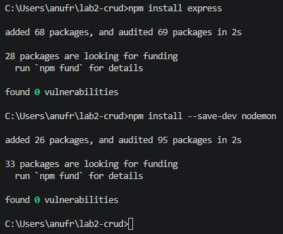

---

### Шаг 2. Настройка package.json

В файле `package.json` добавляем скрипты для запуска:

```json
"scripts": {
  "start": "node app.js",
  "dev": "nodemon app.js"
}
```

**Скриншот 2 — package.json:**

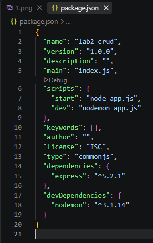

---

### Шаг 3. Создание сервера с CRUD-операциями

Создаём файл `app.js` с полным кодом для продвинутого уровня:

```javascript
const express = require('express');
const fs = require('fs');
const path = require('path');
const app = express();
const port = 3000;

// Middleware для парсинга JSON
app.use(express.json());

// ============ ЛОГИРОВАНИЕ В ФАЙЛ ============
const logStream = fs.createWriteStream(path.join(__dirname, 'access.log'), { flags: 'a' });

app.use((req, res, next) => {
  const logLine = `[${new Date().toISOString()}] ${req.method} ${req.url}\n`;
  console.log(logLine.trim());
  logStream.write(logLine);
  next();
});

// ============ ХРАНИЛИЩЕ ДАННЫХ ============
let users = [
  { id: 1, name: 'Иван Иванов', email: 'ivan@example.com' },
  { id: 2, name: 'Пётр Петров', email: 'petr@example.com' },
  { id: 3, name: 'Анна Сидорова', email: 'anna@example.com' },
  { id: 4, name: 'Мария Смирнова', email: 'maria@example.com' },
  { id: 5, name: 'Алексей Кузнецов', email: 'alex@example.com' }
];

let nextId = 6;

// ============ ВАЛИДАЦИЯ ============
function validateUser(body, isPatch = false) {
  const errors = [];

  if (!isPatch || body.name !== undefined) {
    if (!body.name || typeof body.name !== 'string' || body.name.trim() === '') {
      errors.push('Поле name обязательно и должно быть непустой строкой');
    }
  }

  if (!isPatch || body.email !== undefined) {
    if (!body.email || typeof body.email !== 'string') {
      errors.push('Поле email обязательно и должно быть строкой');
    } else {
      const emailRegex = /^[^\s@]+@[^\s@]+\.[^\s@]+$/;
      if (!emailRegex.test(body.email)) {
        errors.push('Email имеет неверный формат');
      }
    }
  }

  return errors;
}

// ============ CRUD-ОПЕРАЦИИ ============

// GET /users – список с поиском, сортировкой, пагинацией
app.get('/users', (req, res) => {
  let result = [...users];

  // Поиск по name
  const search = req.query.search;
  if (search) {
    result = result.filter(u =>
      u.name.toLowerCase().includes(search.toLowerCase())
    );
  }

  // Сортировка
  const sortField = req.query.sort;
  const order = req.query.order === 'desc' ? -1 : 1;
  if (sortField && ['id', 'name', 'email'].includes(sortField)) {
    result.sort((a, b) => {
      if (a[sortField] < b[sortField]) return -1 * order;
      if (a[sortField] > b[sortField]) return 1 * order;
      return 0;
    });
  }

  // Пагинация
  const page = parseInt(req.query.page) || 1;
  const limit = parseInt(req.query.limit) || 10;
  const startIndex = (page - 1) * limit;
  const endIndex = page * limit;
  const paginated = result.slice(startIndex, endIndex);

  res.json({
    total: result.length,
    page: page,
    limit: limit,
    count: paginated.length,
    users: paginated
  });
});

// GET /users/stats – статистика
app.get('/users/stats', (req, res) => {
  const total = users.length;
  const domains = {};
  users.forEach(u => {
    const domain = u.email.split('@')[1];
    domains[domain] = (domains[domain] || 0) + 1;
  });

  res.json({
    totalUsers: total,
    domains: domains,
    averageNameLength: total > 0
      ? (users.reduce((sum, u) => sum + u.name.length, 0) / total).toFixed(2)
      : 0
  });
});

// GET /users/:id/related – связанные (по домену email)
app.get('/users/:id/related', (req, res) => {
  const id = parseInt(req.params.id);
  const user = users.find(u => u.id === id);
  if (!user) {
    return res.status(404).json({ error: 'Пользователь не найден' });
  }

  const domain = user.email.split('@')[1];
  const related = users.filter(u => u.id !== id && u.email.endsWith('@' + domain));

  res.json({
    user: user,
    relatedByDomain: related
  });
});

// GET /users/:id – один пользователь
app.get('/users/:id', (req, res) => {
  const id = parseInt(req.params.id);
  const user = users.find(u => u.id === id);
  if (!user) {
    return res.status(404).json({ error: 'Пользователь не найден' });
  }
  res.json(user);
});

// POST /users – создание
app.post('/users', (req, res) => {
  const errors = validateUser(req.body);
  if (errors.length > 0) {
    return res.status(400).json({ errors });
  }

  const newUser = {
    id: nextId++,
    name: req.body.name.trim(),
    email: req.body.email.trim()
  };
  users.push(newUser);
  res.status(201).json(newUser);
});

// POST /users/bulk – массовое создание
app.post('/users/bulk', (req, res) => {
  if (!Array.isArray(req.body)) {
    return res.status(400).json({ error: 'Ожидается массив пользователей' });
  }

  const created = [];
  const errors = [];

  req.body.forEach((item, index) => {
    const itemErrors = validateUser(item);
    if (itemErrors.length > 0) {
      errors.push({ index, errors: itemErrors });
    } else {
      const newUser = {
        id: nextId++,
        name: item.name.trim(),
        email: item.email.trim()
      };
      users.push(newUser);
      created.push(newUser);
    }
  });

  if (errors.length > 0 && created.length === 0) {
    return res.status(400).json({ errors });
  }

  res.status(201).json({
    created: created,
    errors: errors.length > 0 ? errors : undefined
  });
});

// PUT /users/:id – полное обновление
app.put('/users/:id', (req, res) => {
  const id = parseInt(req.params.id);
  const index = users.findIndex(u => u.id === id);
  if (index === -1) {
    return res.status(404).json({ error: 'Пользователь не найден' });
  }

  const errors = validateUser(req.body);
  if (errors.length > 0) {
    return res.status(400).json({ errors });
  }

  users[index] = {
    id: id,
    name: req.body.name.trim(),
    email: req.body.email.trim()
  };

  res.json(users[index]);
});

// PATCH /users/:id – частичное обновление
app.patch('/users/:id', (req, res) => {
  const id = parseInt(req.params.id);
  const index = users.findIndex(u => u.id === id);
  if (index === -1) {
    return res.status(404).json({ error: 'Пользователь не найден' });
  }

  const errors = validateUser(req.body, true);
  if (errors.length > 0) {
    return res.status(400).json({ errors });
  }

  if (req.body.name !== undefined) users[index].name = req.body.name.trim();
  if (req.body.email !== undefined) users[index].email = req.body.email.trim();

  res.json(users[index]);
});

// DELETE /users – удалить всех
app.delete('/users', (req, res) => {
  const count = users.length;
  users = [];
  res.status(200).json({ message: `Удалено пользователей: ${count}` });
});

// DELETE /users/:id – удалить одного
app.delete('/users/:id', (req, res) => {
  const id = parseInt(req.params.id);
  const index = users.findIndex(u => u.id === id);
  if (index === -1) {
    return res.status(404).json({ error: 'Пользователь не найден' });
  }

  users.splice(index, 1);
  res.status(204).send();
});

// ============ ОБРАБОТКА 404 ============
app.use((req, res) => {
  res.status(404).json({ error: 'Маршрут не найден' });
});

// ============ ГЛОБАЛЬНЫЙ ОБРАБОТЧИК ОШИБОК ============
app.use((err, req, res, next) => {
  console.error('Ошибка:', err.message);
  res.status(500).json({ error: 'Внутренняя ошибка сервера' });
});

// ============ ЗАПУСК ============
app.listen(port, () => {
  console.log(`Сервер запущен на http://localhost:${port}`);
});
```

---

### Шаг 4. Запуск сервера

Запускаем сервер командой:

```bash
npm run dev
```

В консоли видим сообщение: `Сервер запущен на http://localhost:3000`

**Скриншот 3 — запуск сервера:**

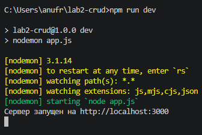

---

## Проверка работы эндпоинтов в Postman

### 1. GET /users — получить всех пользователей

**Запрос:** GET `http://localhost:3000/users`  
**Код ответа:** 200 OK

**Скриншот 4:**

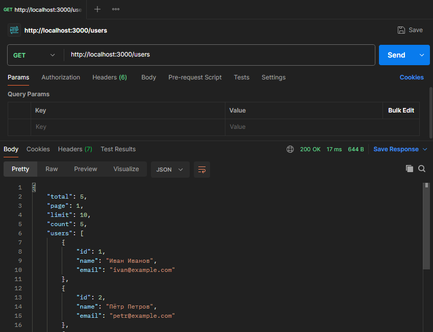

---

### 2. GET /users/1 — получить одного пользователя

**Запрос:** GET `http://localhost:3000/users/1`  
**Код ответа:** 200 OK

**Скриншот 5:**

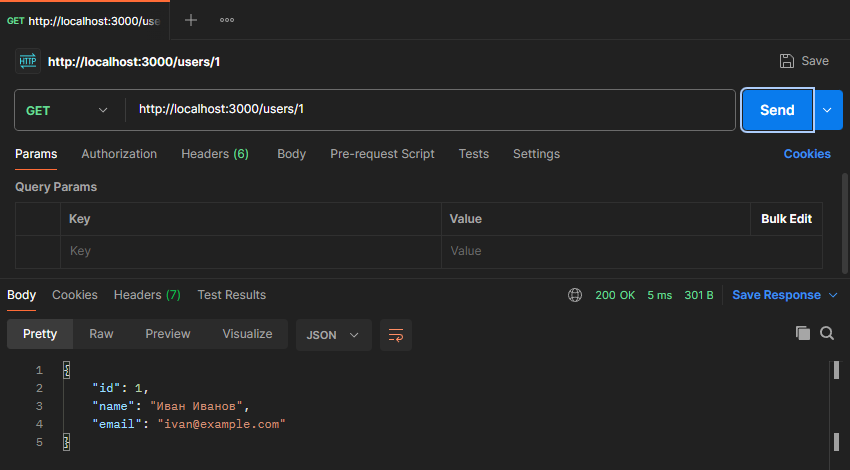

---

### 3. GET /users/999 — обработка 404

**Запрос:** GET `http://localhost:3000/users/999`  
**Код ответа:** 404 Not Found

**Скриншот 6:**

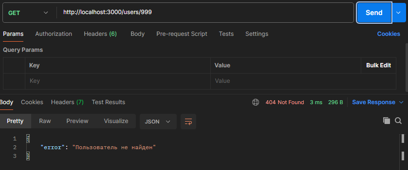

---

### 4. POST /users — создание пользователя (201)

**Запрос:** POST `http://localhost:3000/users`  
**Тело:** `{"name": "Новый Пользователь", "email": "newuser@example.com"}`  
**Код ответа:** 201 Created

**Скриншот 7:**

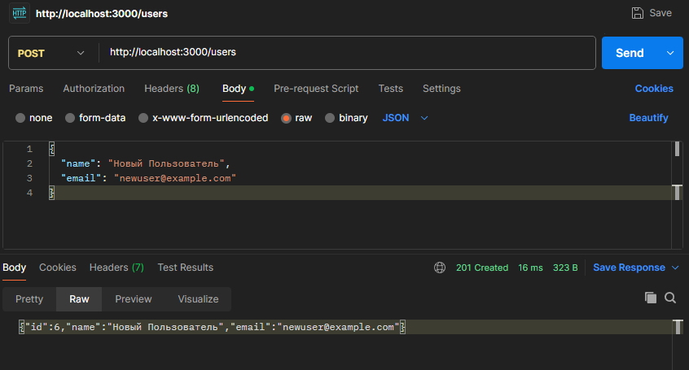

---

### 5. PUT /users/1 — полное обновление (200)

**Запрос:** PUT `http://localhost:3000/users/1`  
**Тело:** `{"name": "Обновлённый Иван", "email": "ivan.new@example.com"}`  
**Код ответа:** 200 OK

**Скриншот 8:**

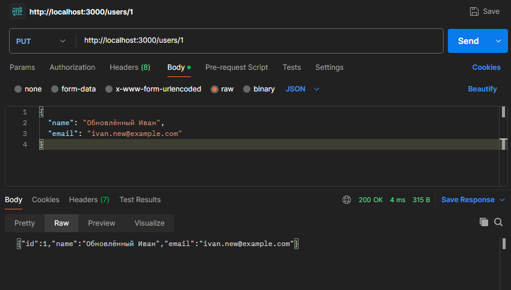

---

### 6. DELETE /users/3 — удаление (204)

**Запрос:** DELETE `http://localhost:3000/users/3`  
**Код ответа:** 204 No Content  
**Тело ответа:** пустое

**Скриншот 9:**

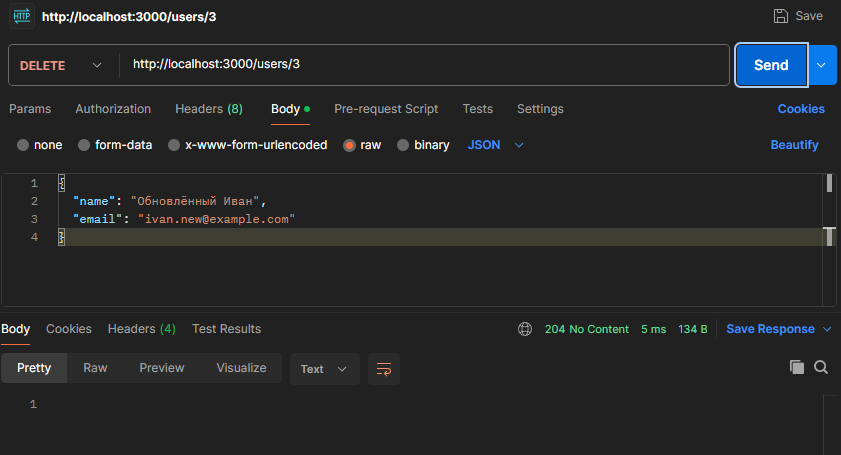

---

### 7. POST /users с пустым телом — валидация (400)

**Запрос:** POST `http://localhost:3000/users`  
**Тело:** `{}`  
**Код ответа:** 400 Bad Request

**Скриншот 10:**

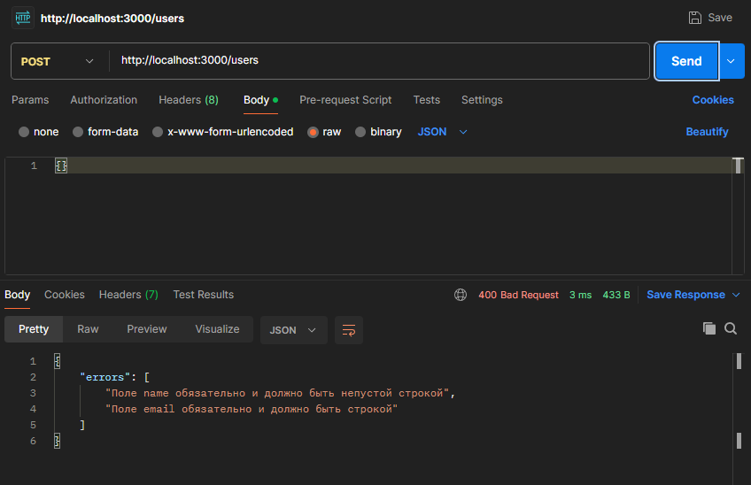

---

### 8. GET /users?search=Иван — поиск

**Запрос:** GET `http://localhost:3000/users?search=Иван`  
**Код ответа:** 200 OK

**Скриншот 11:**

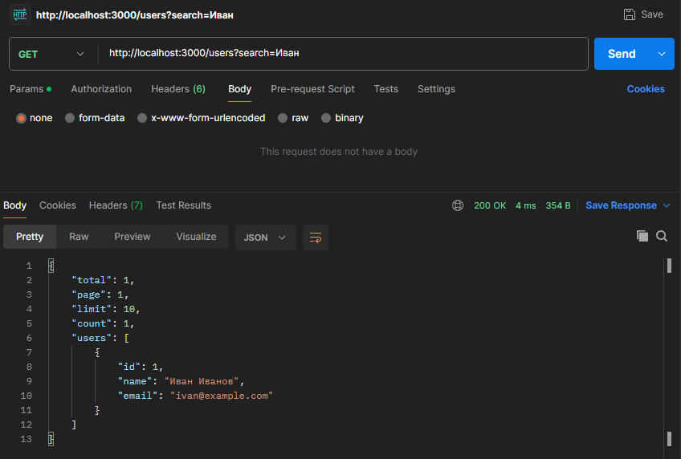

---

### 9. GET /users?sort=name&order=asc — сортировка

**Запрос:** GET `http://localhost:3000/users?sort=name&order=asc`  
**Код ответа:** 200 OK

**Скриншот 12:**

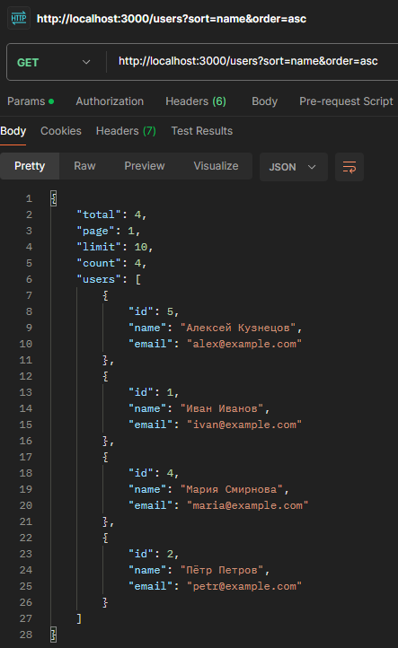

---

### 10. GET /users?page=1&limit=2 — пагинация

**Запрос:** GET `http://localhost:3000/users?page=1&limit=2`  
**Код ответа:** 200 OK

**Скриншот 13:**

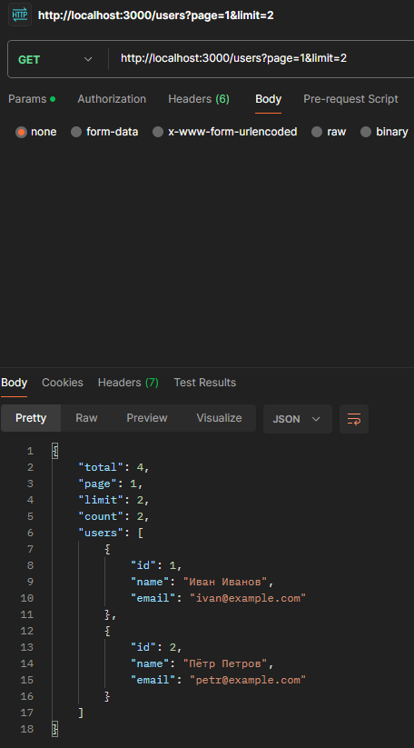

---

### 11. PATCH /users/2 — частичное обновление

**Запрос:** PATCH `http://localhost:3000/users/2`  
**Тело:** `{"email": "patched@example.com"}`  
**Код ответа:** 200 OK

**Скриншот 14:**

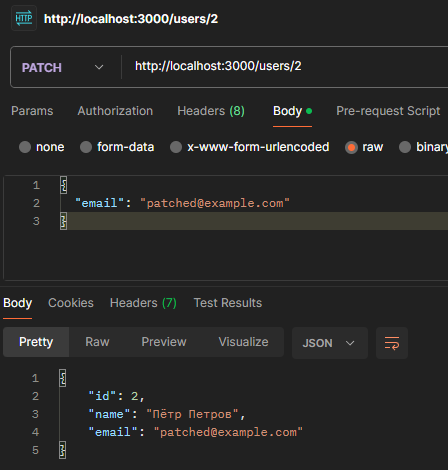

---

### 12. POST /users/bulk — массовое создание

**Запрос:** POST `http://localhost:3000/users/bulk`  
**Тело:** массив из 3 пользователей  
**Код ответа:** 201 Created

**Скриншот 15:**

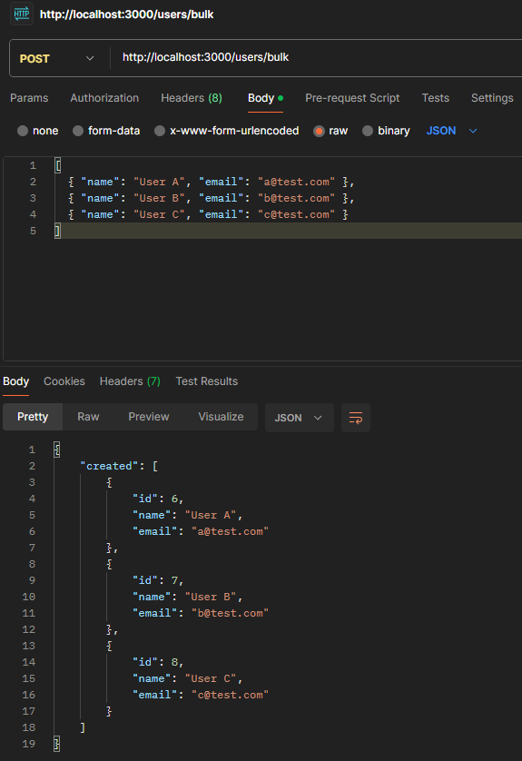

---

### 13. GET /users/stats — статистика

**Запрос:** GET `http://localhost:3000/users/stats`  
**Код ответа:** 200 OK

**Скриншот 16:**

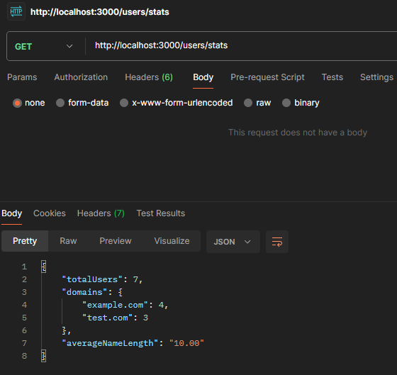

---

### 14. GET /users/6/related — связанные элементы

**Запрос:** GET `http://localhost:3000/users/6/related`  
**Код ответа:** 200 OK

**Скриншот 17:**

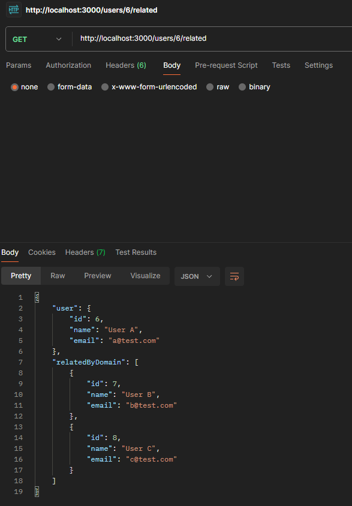

---

### 15. Файл access.log — логирование в файл

Все запросы записываются в файл `access.log` в корне проекта.

**Скриншот 18:**

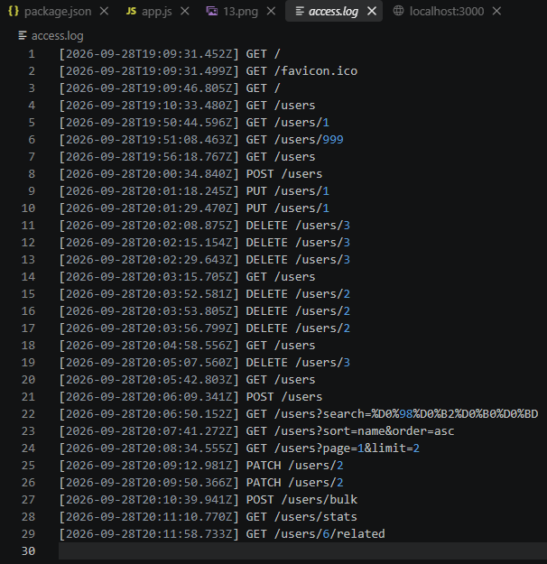

---

## Ответы на контрольные вопросы (продвинутый уровень)

### 1. Как реализовать частичное обновление (PATCH)?

Частичное обновление реализуется через метод `PATCH`. В отличие от `PUT`, который заменяет ресурс целиком, `PATCH` обновляет только те поля, которые были переданы в теле запроса. В коде мы проверяем, какие поля присутствуют в `req.body`, и обновляем только их:

```javascript
if (req.body.name !== undefined) users[index].name = req.body.name.trim();
if (req.body.email !== undefined) users[index].email = req.body.email.trim();
```

Это позволяет не передавать все поля заново, а менять только нужные.

---

### 2. Как реализовать массовое удаление элементов?

Массовое удаление реализуется через эндпоинт `DELETE /users` (без параметра `:id`). В обработчике мы просто очищаем массив:

```javascript
app.delete('/users', (req, res) => {
  const count = users.length;
  users = [];
  res.status(200).json({ message: `Удалено пользователей: ${count}` });
});
```

Возвращаем количество удалённых элементов и код 200 OK.

---

### 3. Как реализовать массовое создание элементов?

Массовое создание реализуется через эндпоинт `POST /users/bulk`. В теле запроса передаётся массив объектов. Мы проходим по нему, валидируем каждый элемент и добавляем в массив `users`:

```javascript
app.post('/users/bulk', (req, res) => {
  if (!Array.isArray(req.body)) {
    return res.status(400).json({ error: 'Ожидается массив пользователей' });
  }
  // ... проход по массиву, валидация, добавление
});
```

Возвращаем массив созданных элементов и код 201 Created.

---

### 4. Как реализовать глобальный обработчик ошибок?

Глобальный обработчик ошибок в Express — это middleware с **четырьмя** аргументами: `(err, req, res, next)`. Он ставится **после** всех маршрутов и вызывается при любой ошибке:

```javascript
app.use((err, req, res, next) => {
  console.error('Ошибка:', err.message);
  res.status(500).json({ error: 'Внутренняя ошибка сервера' });
});
```

Это позволяет централизованно обрабатывать все непредвиденные ошибки и не раскрывать детали клиенту.

---

### 5. Как логировать запросы в файл?

Логирование в файл реализуется через модуль `fs` и `createWriteStream`. Создаём поток для записи в файл `access.log` и в middleware записываем каждую строку:

```javascript
const fs = require('fs');
const path = require('path');
const logStream = fs.createWriteStream(path.join(__dirname, 'access.log'), { flags: 'a' });

app.use((req, res, next) => {
  const logLine = `[${new Date().toISOString()}] ${req.method} ${req.url}\n`;
  logStream.write(logLine);
  next();
});
```

Флаг `'a'` означает дозапись в конец файла (append). Логи сохраняются между перезапусками сервера.

---

### 6. Что такое REST API и какие принципы лежат в его основе?

**REST (Representational State Transfer)** — это архитектурный стиль для построения веб-API. Основные принципы:

1. **Клиент-серверная архитектура** — клиент и сервер разделены.
2. **Отсутствие состояния (stateless)** — каждый запрос содержит всю необходимую информацию.
3. **Кэшируемость** — ответы могут кэшироваться.
4. **Единообразие интерфейса** — использование стандартных HTTP-методов (GET, POST, PUT, DELETE).
5. **Слои** — клиент не знает, общается он с сервером напрямую или через промежуточные слои.
6. **Код по запросу (опционально)** — сервер может передавать исполняемый код клиенту.

В нашем API мы используем ресурсные URL (`/users`, `/users/:id`) и стандартные HTTP-методы, что соответствует принципам REST.

---

### 7. Как организовать структуру проекта для масштабируемого CRUD API?

Для масштабируемого проекта рекомендуется разделять код на слои:

```
project/
├── src/
│   ├── routes/         # маршруты (users.routes.js)
│   ├── controllers/    # логика обработки запросов (users.controller.js)
│   ├── services/       # бизнес-логика (users.service.js)
│   ├── models/         # модели данных (user.model.js)
│   ├── middleware/     # middleware (logger.js, validator.js)
│   └── app.js          # настройка Express
├── server.js           # точка входа
├── package.json
└── .env                # переменные окружения
```

Это позволяет легко добавлять новые сущности и тестировать код.

---

### 8. Какие существуют стратегии генерации уникальных ID?

1. **Автоинкремент** — простой счётчик (`nextId++`), как в нашей работе. Подходит для in-memory хранилищ.
2. **UUID** — уникальный идентификатор (например, `uuid` или `crypto.randomUUID()`). Хорош для распределённых систем.
3. **Timestamp-based** — ID на основе времени создания (например, `Date.now()`).
4. **Snowflake ID** — комбинированный подход (время + машинный ID + счётчик), используется в Twitter.
5. **MongoDB ObjectId** — 12-байтовый идентификатор, используемый в MongoDB.

В нашей работе используется простой автоинкремент, так как данные хранятся в памяти.

---

### 9. Как защитить API от слишком больших запросов?

1. **Ограничение размера тела запроса** — в Express можно указать лимит:
   ```javascript
   app.use(express.json({ limit: '10kb' }));
   ```
2. **Rate limiting** — ограничение количества запросов с одного IP. Библиотека `express-rate-limit`:
   ```javascript
   const rateLimit = require('express-rate-limit');
   app.use(rateLimit({ windowMs: 15 * 60 * 1000, max: 100 }));
   ```
3. **Валидация входных данных** — проверка типов и длины полей.
4. **Таймауты** — ограничение времени обработки запроса.
5. **Прокси и балансировщики** — Nginx может отсекать слишком большие запросы до попадания на сервер.

---

### 10. Как реализовать связь между сущностями?

Связь между сущностями реализуется через **внешние ключи** (foreign keys). Например, если у нас есть сущности `users` и `tasks`, то у задачи может быть поле `userId`, указывающее на владельца:

```javascript
let tasks = [
  { id: 1, title: 'Задача 1', userId: 1 },
  { id: 2, title: 'Задача 2', userId: 2 }
];
```

Чтобы получить все задачи пользователя:

```javascript
app.get('/users/:id/tasks', (req, res) => {
  const userId = parseInt(req.params.id);
  const userTasks = tasks.filter(t => t.userId === userId);
  res.json(userTasks);
});
```

В нашей работе связь реализована по домену email: эндпоинт `GET /users/:id/related` возвращает пользователей с тем же доменом, что и указанный.

---

## Вывод

В ходе лабораторной работы я освоил обработку HTTP-методов (GET, POST, PUT, PATCH, DELETE) в Express и реализовал полноценный CRUD API для сущности «Пользователи» с хранением данных в памяти сервера.

**Что было сделано:**
- Настроен проект Node.js + Express с автоматическим перезапуском через Nodemon.
- Реализованы базовые CRUD-операции: получение списка, получение одного, создание, полное обновление, удаление.
- Добавлена валидация входных данных с возвратом кода 400 при ошибках.
- Реализованы поиск (по имени), сортировка (по любому полю), пагинация.
- Добавлен PATCH для частичного обновления.
- Реализованы массовые операции: удаление всех (`DELETE /users`) и создание нескольких (`POST /users/bulk`).
- Добавлены дополнительные эндпоинты: статистика (`/users/stats`) и связанные элементы (`/users/:id/related`).
- Настроено логирование всех запросов в файл `access.log`.
- Реализован глобальный обработчик ошибок (500).

**Что нового узнал:**
- Разница между PUT и PATCH: PUT заменяет ресурс целиком, PATCH — только переданные поля.
- Как работает middleware в Express и как создать собственный логгер.
- Как организовать поиск, сортировку и пагинацию через query-параметры.
- Как реализовать глобальный обработчик ошибок с четырьмя аргументами.
- Как логировать запросы в файл через `fs.createWriteStream`.
- Принципы REST API и стратегии генерации уникальных ID.

**С какими трудностями столкнулся:**
- При выборе формата JSON в Postman lightweight-версии возникли сложности с активацией поля Body — решилось переключением метода на POST и выбором `raw`.
- При повторном DELETE одного и того же ID возвращался 404 — это ожидаемое поведение, так как ресурс уже удалён.
- Пришлось следить за порядком маршрутов: `/users/stats` должен идти **до** `/users/:id`, иначе Express попытается интерпретировать `stats` как ID.

---

## Список использованных источников

1. Express.js Documentation — https://expressjs.com/
2. MDN Web Docs: HTTP-методы — https://developer.mozilla.org/ru/docs/Web/HTTP/Methods
3. Postman Learning Center — https://learning.postman.com/
4. Node.js Documentation: fs module — https://nodejs.org/api/fs.html
5. REST API Tutorial — https://restfulapi.net/
6. Методические указания к лабораторной работе №2.