# Лабораторная работа №3: Маршрутизация, параметры пути и query-параметры

**Студент:** Ануфриев Владислав Денисович  
**Группа:** ПИЖ-б-о-25-2  
**Вариант:** 3 (Node.js + Express)  
**Уровень:** Продвинутый  
**Технология:** Node.js + Express

---

## Цель работы

Освоить различные способы передачи данных через URL. Научиться строить гибкие маршруты с параметрами пути и query-параметрами, комбинировать их, обрабатывать вложенные ресурсы и валидировать входные данные. Понять разницу между `req.params`, `req.query` и `req.body`.

---

## Теоретическое обоснование

### Что такое маршрутизация

**Маршрутизация (routing)** — это механизм сопоставления HTTP-запроса (метод + URL) с кодом-обработчиком на сервере. Каждый маршрут определяет, какой код выполнится при обращении клиента по конкретному адресу.

В Express маршрут описывается как `app.METHOD(PATH, HANDLER)`:
- `METHOD` — HTTP-метод (get, post, put, delete, patch).
- `PATH` — путь URL (может содержать параметры).
- `HANDLER` — функция-обработчик, принимающая `req` и `res`.

---

### Три источника данных в запросе

При обработке запроса сервер может получать данные из трёх мест:

| Источник | Где находится | Express |
|----------|---------------|---------|
| **Параметры пути** | Часть URL: `/users/42` | `req.params.id` |
| **Query-параметры** | После `?`: `/users?age=20` | `req.query.age` |
| **Тело запроса** | Тело POST/PUT/PATCH | `req.body` |

**Важно:** параметры пути и query-параметры передаются в URL, тело запроса — отдельно.

---

### Параметры пути (route parameters)

Параметр пути — это именованная часть URL, которая извлекается сервером и передаётся в обработчик. Пример: `GET /users/42`, где параметр `id = 42`.

**Особенности:**
1. Параметр всегда строка в Express (нужен `parseInt`).
2. Параметров может быть несколько: `/posts/:postId/comments/:commentId`.
3. Параметры могут быть необязательными: `/users/:id?`.

**Пример:**
~~~javascript
app.get('/cities/:id', (req, res) => {
  const id = parseInt(req.params.id);
  res.json({ cityId: id });
});
~~~

---

### Query-параметры (query string)

Query-параметры — это пары «ключ=значение», передаваемые после `?` в URL. Они используются для фильтрации, сортировки, пагинации, поиска.

**Пример:** `GET /cities?search=Москва&sort=population&order=desc&page=1&limit=10`

**Особенности:**
1. Query-параметры всегда строки (нужно приводить типы).
2. Могут быть множественные значения: `?tag=js&tag=node`.
3. Отсутствие параметра — `undefined` в Express.
4. Значения по умолчанию нужно задавать явно.

---

### Вложенные маршруты (nested routes)

Вложенные маршруты отражают иерархию ресурсов: один ресурс принадлежит другому.
- `GET /users/42/posts` — все посты пользователя 42.
- `GET /users/42/posts/7` — пост 7 пользователя 42.

---

### Wildcard-маршруты и приоритеты

Wildcard-маршрут соответствует любому пути. Используется для обработки 404 или для SPA.

**Правило:** более специфичные маршруты должны идти раньше более общих. Express проверяет маршруты в порядке объявления. Wildcard ставится **последним**.

~~~javascript
app.use((req, res) => {
  res.status(404).json({ error: 'Маршрут не найден' });
});
~~~

---

### Валидация параметров

Параметры приходят как строки, поэтому нужна валидация:
- `id` — целое положительное число.
- `page`, `limit` — целые положительные, `limit ≤ 100`.
- `sort` — из белого списка полей.
- `order` — `asc` или `desc`.
- `search` — строка, не слишком длинная.

---

## Выполнение практического примера

### Шаг 1. Подготовка проекта

Создаём папку проекта и устанавливаем зависимости:

~~~bash
mkdir lab3-routing-params
cd lab3-routing-params
npm init -y
npm install express
npm install --save-dev nodemon
~~~

В файле `package.json` добавляем скрипты для запуска:

~~~json
"scripts": {
  "start": "node app.js",
  "dev": "nodemon app.js"
}
~~~

---

### Шаг 2. Создание сервера с маршрутизацией

Создаём файл `app.js` с полным кодом для продвинутого уровня:

~~~javascript
const express = require('express');
const app = express();
const port = 3000;

app.use(express.json());

// Логирование запросов
app.use((req, res, next) => {
  console.log(`[${new Date().toISOString()}] ${req.method} ${req.url}`);
  next();
});

// ============== ДАННЫЕ ==============
const cities = [
  { id: 1, name: 'Москва', population: 13000000, country: 'Россия', area: 2561 },
  { id: 2, name: 'Санкт-Петербург', population: 5600000, country: 'Россия', area: 1439 },
  { id: 3, name: 'Новосибирск', population: 1600000, country: 'Россия', area: 505 },
  { id: 4, name: 'Екатеринбург', population: 1500000, country: 'Россия', area: 1112 },
  { id: 5, name: 'Казань', population: 1250000, country: 'Россия', area: 425 }
];

const allowedSortFields = ['id', 'name', 'population', 'area'];

// ============== ВСПОМОГАТЕЛЬНЫЕ ==============
function parsePositiveInt(value) {
  const n = Number(value);
  return Number.isInteger(n) && n >= 1 ? n : null;
}

// ============== БАЗОВЫЙ + СРЕДНИЙ УРОВЕНЬ ==============
// GET /cities — список + поиск + фильтр + сортировка + пагинация
app.get('/cities', (req, res) => {
  let result = [...cities];

  const search = req.query.search;
  if (search) {
    result = result.filter(c => c.name.toLowerCase().includes(String(search).toLowerCase()));
  }

  const country = req.query.country;
  if (country) {
    result = result.filter(c => c.country.toLowerCase() === String(country).toLowerCase());
  }

  const sort = req.query.sort;
  const order = req.query.order || 'asc';

  if (sort) {
    if (!allowedSortFields.includes(sort)) {
      return res.status(400).json({ error: `Поле сортировки должно быть одним из: ${allowedSortFields.join(', ')}` });
    }
    if (!['asc', 'desc'].includes(order)) {
      return res.status(400).json({ error: 'Параметр order должен быть asc или desc' });
    }
    result.sort((a, b) => {
      if (a[sort] === b[sort]) return 0;
      const cmp = a[sort] > b[sort] ? 1 : -1;
      return order === 'desc' ? -cmp : cmp;
    });
  }

  const page = req.query.page === undefined ? 1 : parseInt(req.query.page, 10);
  const limit = req.query.limit === undefined ? 10 : parseInt(req.query.limit, 10);

  if (Number.isNaN(page) || page < 1) {
    return res.status(400).json({ error: 'page должен быть целым числом >= 1' });
  }
  if (Number.isNaN(limit) || limit < 1 || limit > 100) {
    return res.status(400).json({ error: 'limit должен быть целым числом от 1 до 100' });
  }

  const start = (page - 1) * limit;
  const paginated = result.slice(start, start + limit);

  res.json({
    count: result.length,
    page,
    limit,
    totalPages: Math.ceil(result.length / limit) || 0,
    cities: paginated
  });
});

// GET /cities/:id — один город
app.get('/cities/:id', (req, res) => {
  const id = parsePositiveInt(req.params.id);
  if (id === null) {
    return res.status(400).json({ error: 'ID должен быть положительным целым числом' });
  }

  const city = cities.find(c => c.id === id);
  if (!city) {
    return res.status(404).json({ error: 'Город не найден' });
  }

  res.json(city);
});

// GET /cities/:id/area — площадь города
app.get('/cities/:id/area', (req, res) => {
  const id = parsePositiveInt(req.params.id);
  if (id === null) {
    return res.status(400).json({ error: 'ID должен быть положительным целым числом' });
  }

  const city = cities.find(c => c.id === id);
  if (!city) {
    return res.status(404).json({ error: 'Город не найден' });
  }

  res.json({ city: city.name, area: city.area, unit: 'км²' });
});

// GET /countries/:country/cities — города страны
app.get('/countries/:country/cities', (req, res) => {
  const country = req.params.country;
  const filtered = cities.filter(c => c.country.toLowerCase() === country.toLowerCase());
  res.json({ country, count: filtered.length, cities: filtered });
});

// ============== ПРОДВИНУТЫЙ УРОВЕНЬ ==============
// GET /cities/:id/details — детали с вложенными данными
app.get('/cities/:id/details', (req, res) => {
  const id = parsePositiveInt(req.params.id);
  if (id === null) {
    return res.status(400).json({ error: 'ID должен быть положительным целым числом' });
  }

  const city = cities.find(c => c.id === id);
  if (!city) {
    return res.status(404).json({ error: 'Город не найден' });
  }

  const districts = [
    { id: 1, name: 'Центральный', cityId: id },
    { id: 2, name: 'Северный', cityId: id }
  ];

  res.json({
    city,
    districts,
    attractions: ['Кремль', 'Парк', 'Музей']
  });
});

// GET /countries/:country/cities/:cityId — город в стране
app.get('/countries/:country/cities/:cityId', (req, res) => {
  const { country, cityId } = req.params;

  const id = parsePositiveInt(cityId);
  if (id === null) {
    return res.status(400).json({ error: 'cityId должен быть положительным целым числом' });
  }

  const city = cities.find(c => c.id === id && c.country.toLowerCase() === country.toLowerCase());

  if (!city) {
    return res.status(404).json({ error: `Город с ID=${cityId} не найден в стране ${country}` });
  }

  res.json({ country, city });
});

// ============== 404 (wildcard — всегда последним) ==============
app.use((req, res) => {
  res.status(404).json({ error: 'Маршрут не найден' });
});

app.listen(port, () => {
  console.log(`Сервер запущен на http://localhost:${port}`);
});
~~~

---

### Шаг 3. Запуск сервера

Запускаем сервер командой:

~~~bash
npm run dev
~~~

В консоли видим сообщение: `Сервер запущен на http://localhost:3000`

---

## Проверка работы эндпоинтов в Postman

### 1. GET /cities — получить все города
**Запрос:** GET `http://localhost:3000/cities`  
**Код ответа:** 200 OK

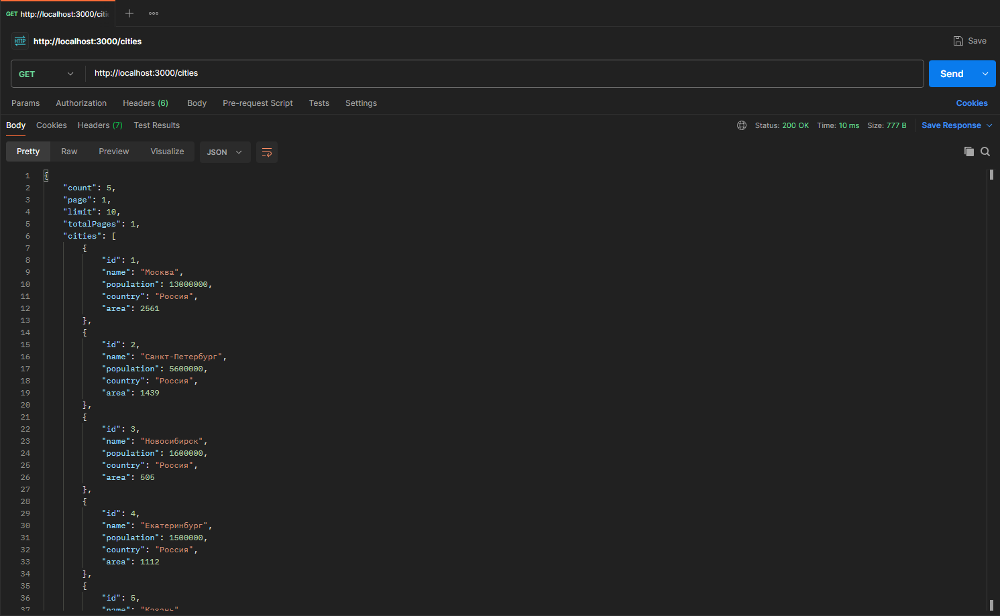

---

### 2. GET /cities/1 — получить один город
**Запрос:** GET `http://localhost:3000/cities/1`  
**Код ответа:** 200 OK

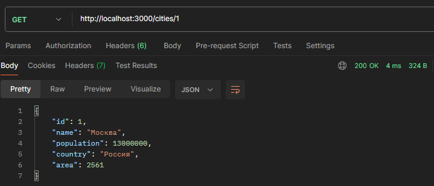

---

### 3. GET /cities/999 — обработка 404 (город не найден)
**Запрос:** GET `http://localhost:3000/cities/999`  
**Код ответа:** 404 Not Found

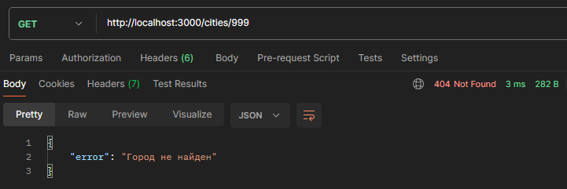

---

### 4. GET /cities/abc — валидация ID (400)
**Запрос:** GET `http://localhost:3000/cities/abc`  
**Код ответа:** 400 Bad Request

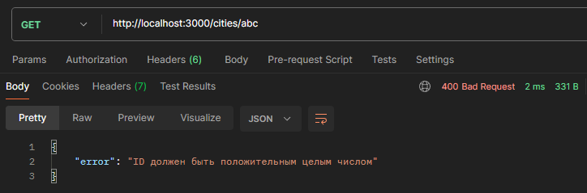

---

### 5. GET /cities/1/area — площадь города
**Запрос:** GET `http://localhost:3000/cities/1/area`  
**Код ответа:** 200 OK

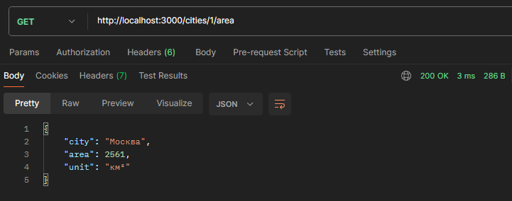

---

### 6. GET /countries/Россия/cities — города страны
**Запрос:** GET `http://localhost:3000/countries/Россия/cities`  
**Код ответа:** 200 OK

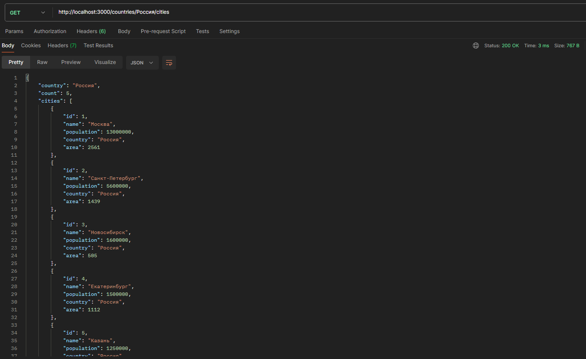

---

### 7. GET /cities?search=Москва — поиск
**Запрос:** GET `http://localhost:3000/cities?search=Москва`  
**Код ответа:** 200 OK

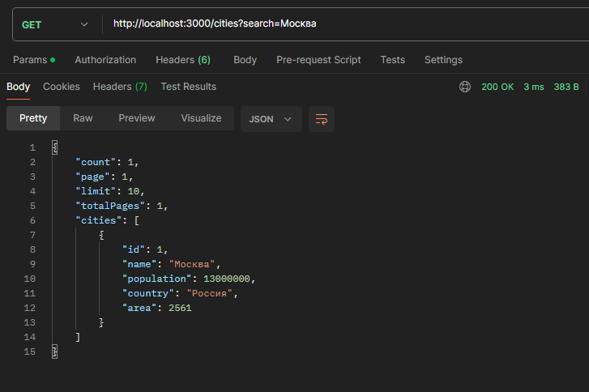

---

### 8. GET /cities?sort=population&order=desc — сортировка
**Запрос:** GET `http://localhost:3000/cities?sort=population&order=desc`  
**Код ответа:** 200 OK

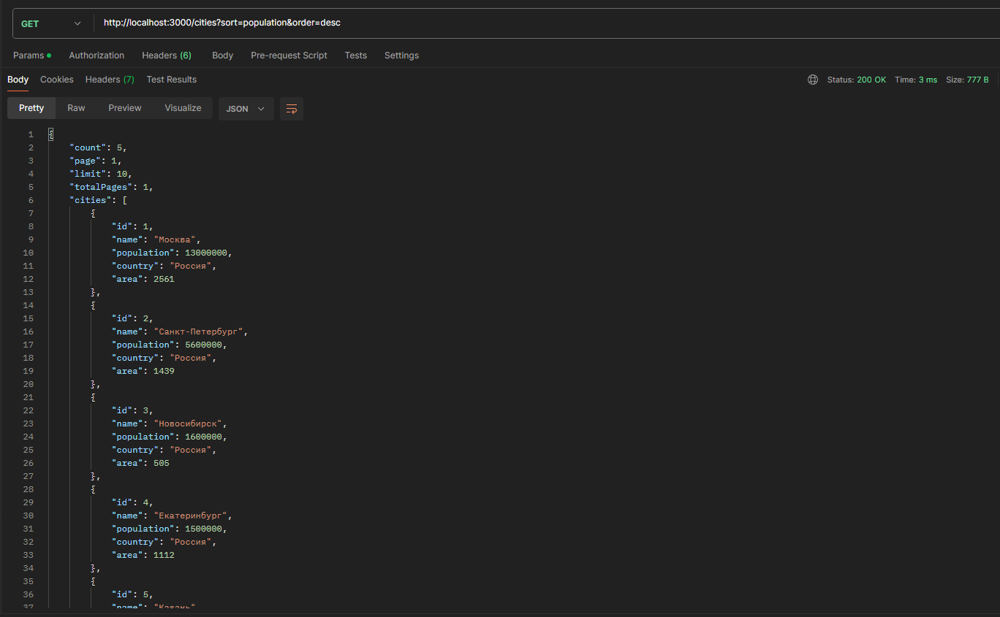

---

### 9. GET /cities?page=1&limit=2 — пагинация
**Запрос:** GET `http://localhost:3000/cities?page=1&limit=2`  
**Код ответа:** 200 OK

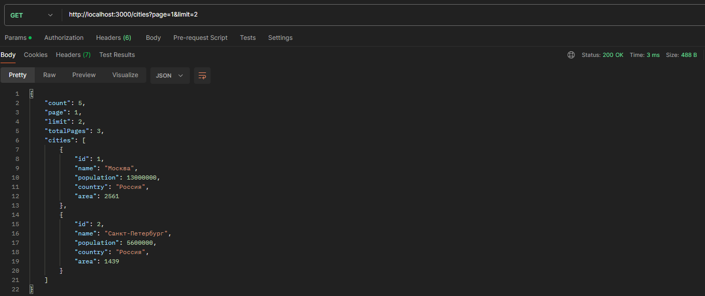

---

### 10. GET /cities/1/details — детали с вложенными данными (Продвинутый уровень)
**Запрос:** GET `http://localhost:3000/cities/1/details`  
**Код ответа:** 200 OK

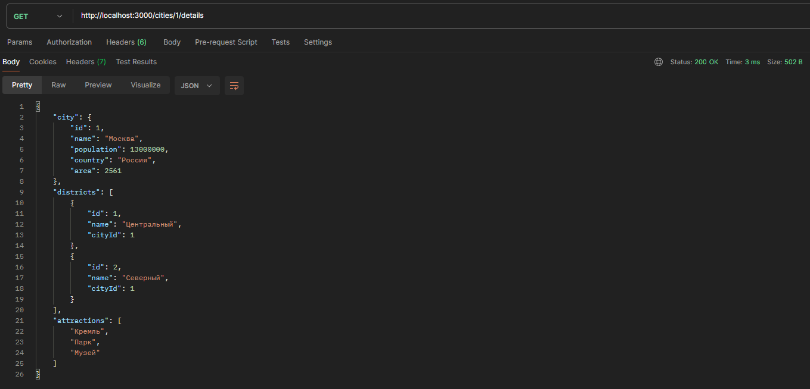

---

### 11. GET /countries/Россия/cities/1 — город в стране (Продвинутый уровень)
**Запрос:** GET `http://localhost:3000/countries/Россия/cities/1`  
**Код ответа:** 200 OK

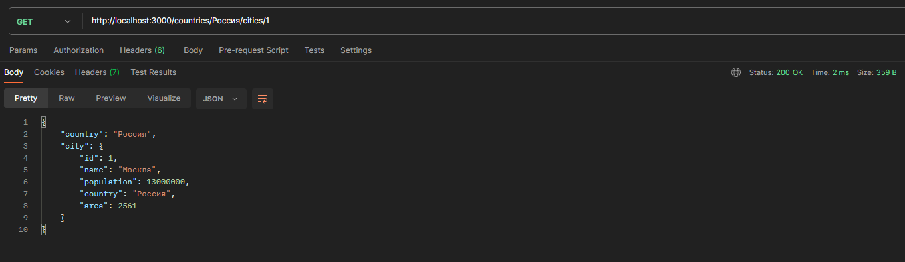

---

### 12. GET /anything-else — обработка 404 (маршрут не найден)
**Запрос:** GET `http://localhost:3000/anything-else`  
**Код ответа:** 404 Not Found

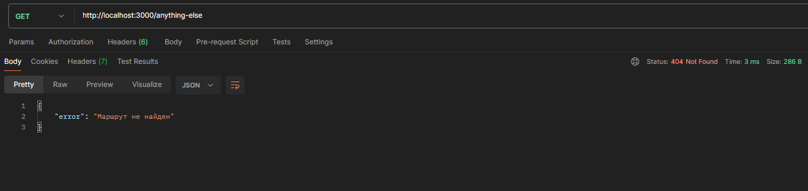

---

### 13. GET /cities?limit=200 — валидация limit (400)
**Запрос:** GET `http://localhost:3000/cities?limit=200`  
**Код ответа:** 400 Bad Request

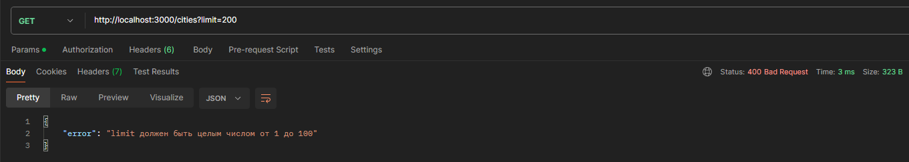

---

### 14. GET /cities?sort=invalid — валидация поля сортировки (400)
**Запрос:** GET `http://localhost:3000/cities?sort=invalid`  
**Код ответа:** 400 Bad Request

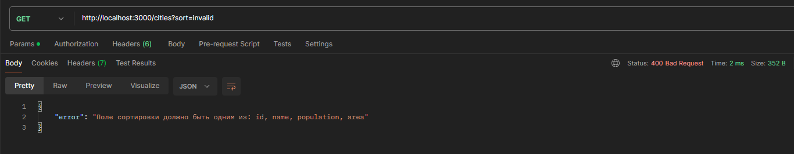

---

### 15. GET /cities?page=0 — валидация page (400)
**Запрос:** GET `http://localhost:3000/cities?page=0`  
**Код ответа:** 400 Bad Request

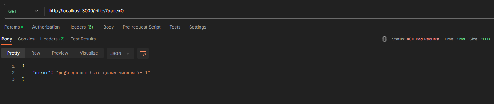

---

### 16. GET /cities?sort=id&order=invalid — валидация order (400)
**Запрос:** GET `http://localhost:3000/cities?sort=id&order=invalid`  
**Код ответа:** 400 Bad Request

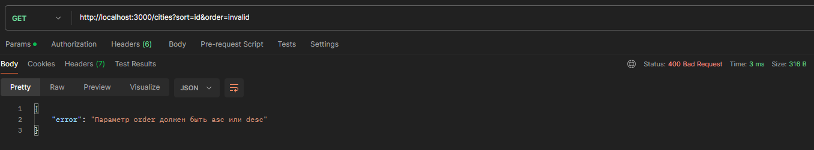

---

### 17. GET /countries/Германия/cities/1 — 404 (город не найден в стране)
**Запрос:** GET `http://localhost:3000/countries/Германия/cities/1`  
**Код ответа:** 404 Not Found

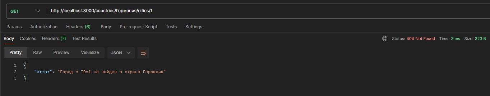

---

## Ответы на контрольные вопросы (продвинутый уровень)

### 1. В чем разница между `req.params`, `req.query` и `req.body`?
- `req.params` — параметры пути (часть URL), используются для идентификации ресурса (например, `/users/42`).
- `req.query` — query-параметры (после `?`), используются для фильтрации, сортировки, поиска (например, `/users?age=20`).
- `req.body` — тело запроса (передается в POST/PUT/PATCH), используется для создания или обновления ресурса.

### 2. Как в Express задать необязательный параметр пути?
В Express 4.x+ необязательный параметр обозначается знаком вопроса: `/users/:id?`. Если параметр не передан, в `req.params` его не будет (или он будет `undefined`).

### 3. Почему важно соблюдать порядок объявления маршрутов?
Express проверяет маршруты сверху вниз. Если маршрут с параметром (например, `/users/:id`) объявлен раньше статичного (например, `/users/stats`), то запрос к `/users/stats` попадет в обработчик `:id` (где `id="stats"`). Поэтому специфичные маршруты должны идти первыми, а wildcard-маршруты (404) — всегда последними.

### 4. Как реализовать обработку 404 в Express?
Обработка 404 реализуется через middleware, которое ставится после всех маршрутов. Оно не требует пути:
~~~javascript
app.use((req, res) => {
  res.status(404).json({ error: 'Маршрут не найден' });
});
~~~

### 5. Как комбинировать параметры пути и query-параметры?
Они обрабатываются независимо. В одном запросе можно использовать и то, и другое. Например, `GET /users/42/posts?sort=date&limit=10`. В обработчике `req.params.id` вернет `42`, а `req.query.sort` вернет `date`.

---

## Вывод

В ходе лабораторной работы я освоил механизмы маршрутизации в Express и реализовал гибкое API для сущности «Города» (и связанной сущности «Страны»).

**Что было сделано:**
- Настроен проект Node.js + Express.
- Реализованы базовые маршруты с параметрами пути (`/cities/:id`).
- Добавлена обработка query-параметров для поиска, фильтрации, сортировки и пагинации.
- Реализован продвинутый уровень: вложенные маршруты (`/cities/:id/details`) и комбинированные параметры (`/countries/:country/cities/:cityId`).
- Настроена строгая валидация входящих параметров (проверка на целые числа, белый список полей сортировки, ограничение `limit`).
- Реализована корректная обработка ошибок (400 Bad Request при неверных параметрах и 404 Not Found при отсутствии ресурса или маршрута).

**Что нового узнал:**
- Разницу между параметрами пути и query-параметрами, а также способы их извлечения.
- Как работают вложенные маршруты и как комбинировать несколько параметров пути в одном URL.
- Важность порядка объявления маршрутов и принцип работы wildcard-обработчика 404.
- Как правильно валидировать параметры, приходящие в виде строк, и возвращать соответствующие HTTP-коды.

**С какими трудностями столкнулся:**
- При передаче кириллицы в параметрах пути (например, `/countries/Россия/...`) Postman автоматически кодирует URL, но в коде нужно было убедиться, что сравнение строк происходит корректно (использован `toLowerCase()`).
- Пришлось следить за тем, чтобы middleware для логирования и парсинга JSON (`express.json()`) были объявлены до маршрутов.
- Понял, что `parseInt('abc')` возвращает `NaN`, поэтому для валидации ID использовал строгую проверку через `Number.isInteger()`.

---

## Список использованных источников

1. Express.js Documentation — https://expressjs.com/
2. MDN Web Docs: Маршрутизация — https://developer.mozilla.org/ru/docs/Learn/Server-side/Express_Nodejs/routes
3. Postman Learning Center — https://learning.postman.com/
4. REST API Tutorial — https://restfulapi.net/
5. Методические указания к лабораторной работе №3.